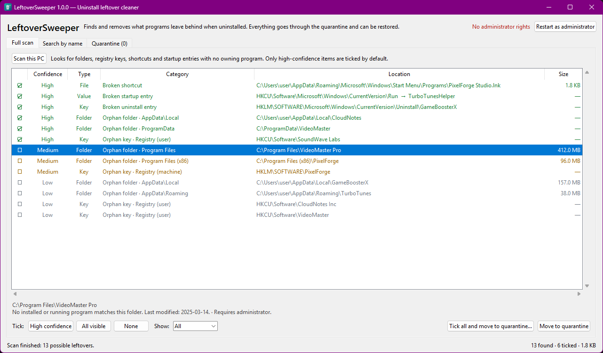
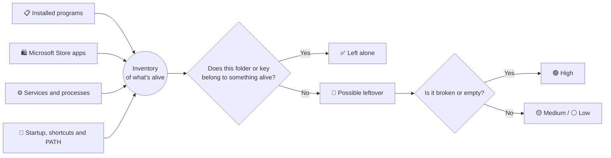

<div align="center">


# LeftoverSweeper

**You uninstalled the program. The program didn't quite leave.**

*Ghost folders, orphan registry keys, shortcuts to nowhere…
LeftoverSweeper finds them, shows them to you and sweeps them away without fear, because everything can be undone.*

[](https://github.com/HiddenOnLies/LeftoverSweeper/releases/latest/download/LeftoverSweeper.exe)


</div>

---

<p align="center">
  
  <br><sub>Screenshot with demo data.</sub>
</p>

## 👻 The problem

Every "official" uninstaller leaves something behind:

```
C:\Program Files\VideoMaster Pro\           ← 412 MB from a program that no longer exists
%APPDATA%\TurboTunes\                       ← settings from two years ago
HKCU\Software\SoundWave Labs                ← orphan registry key
Start menu › PixelForge Studio.lnk          ← a shortcut that opens nothing
Run › TurboTunesHelper                      ← Windows tries to launch it on every boot
```

One by one they weigh nothing. Together they add up to gigabytes of junk, a cluttered registry and silent errors at startup.

## ✨ What it does

| | |
|---|---|
| 🔍 **Full scan** | Checks Program Files, ProgramData, AppData, the registry, the Start menu, the desktop and startup programs. |
| 🎯 **Search by name** | Just removed "Wondershare"? Type it in and see everything it left behind. |
| 🚦 **Confidence levels** | 🟢 High, 🟡 Medium or ⚪ Low. Only 🟢 High items, which are clearly broken, are ticked for you. |
| 🧳 **Quarantine** | Nothing is brute-force deleted: it is moved somewhere safe and restored with one click. |
| 🩺 **Find what broke it** | A program stopped working? Paste its error message into the Quarantine search and the items to restore come up first. |
| 💾 **ZIP backup** | "Tick all and move" offers a backup with a name that makes sense: `LeftoverSweeper Backup 2026-10-21 14.30 (57 items).zip`. |
| 🙈 **Ignore list** | Right-click › "Not a leftover" and it never shows up again. |

## 🧠 How it tells junk from treasure

LeftoverSweeper doesn't guess: it takes an inventory of everything that **is** alive on your PC and flags whatever isn't in it.



A few common-sense rules:

- It **never** flags anything from Windows, Microsoft or hardware vendors (Intel, NVIDIA, AMD, Realtek…).
- A folder modified in the last 30 days drops to ⚪ Low confidence, because someone is still using it.
- A registry key that points to files that still exist is skipped.
- In publisher folders such as `Adobe\` or `Valve\`, each product is checked separately.

## 🛡️ Built not to break anything

> [!IMPORTANT]
> LeftoverSweeper **never deletes directly**. Everything goes through the quarantine first.

- 📦 **Folders and files** are *moved* to `%LOCALAPPDATA%\LeftoverSweeper\Quarantine`.
- 🗝️ **Registry keys** are exported to a `.reg` file before being deleted.
- 🔒 **Files in use**: if anything is open, the folder isn't moved. No half-made copies, ever.
- 🧱 **Hard-coded deny list**: even if you tick them, it refuses to touch Windows, Program Files, AppData, your profile, Documents, Desktop and critical keys such as `Microsoft`, `Classes` or `Policies`.

Once you've checked that everything still works, empty the quarantine from its tab.

## 🚀 Getting started

### Option A: the executable (recommended)

1. Download **[LeftoverSweeper.exe](https://github.com/HiddenOnLies/LeftoverSweeper/releases/latest/download/LeftoverSweeper.exe)** from the [Releases](https://github.com/HiddenOnLies/LeftoverSweeper/releases) page.
2. Open it. No installation needed.
3. Click **Scan this PC**.

> [!NOTE]
> Windows SmartScreen may warn that the app "isn't recognised" because it isn't digitally signed. Click **More info › Run anyway**. If you prefer, use option B and run the source code directly.

### Option B: from source

Requires Python 3.12 or newer and nothing else.

```bash
git clone https://github.com/HiddenOnLies/LeftoverSweeper.git
cd LeftoverSweeper
python LeftoverSweeper/app.py
```

Or double-click `LeftoverSweeper\Start.bat`.

### Build your own .exe

```bash
build.bat
```

Creates `dist\LeftoverSweeper.exe` with [PyInstaller](https://pyinstaller.org).

### Command line (read-only)

```bash
python LeftoverSweeper/scanner.py              # full scan
python LeftoverSweeper/scanner.py wondershare  # leftovers of one program
```

## 🔐 What about administrator rights?

Without them, LeftoverSweeper cleans everything that belongs to **your user**: AppData, your registry, your Start menu and your desktop. To clean Program Files, ProgramData or the machine-wide registry, click **Restart as administrator** inside the app.

> [!TIP]
> If you elevate with a *different* administrator account, the app scans that account's profile (AppData and HKCU), not yours.

## 🗂️ Project layout

```
LeftoverSweeper/
├── app.py        User interface (tkinter)
├── scanner.py    Leftover detection (read-only)
├── cleaner.py    Quarantine, backups and restore
├── qsearch.py    Quarantine search (names, files, error messages)
├── rules.py      What gets scanned and what is untouchable
├── winutil.py    Registry, known folders and processes
└── lnk.py        .lnk shortcut reader
```

## ❓ FAQ

<details>
<summary><b>Can I just tick everything without looking?</b></summary>

You can, and the app lets you, but it's not a great idea with ⚪ Low confidence items. They may include game saves, portable apps or settings you want to keep. That's why "Tick all" offers a ZIP backup first.
</details>

<details>
<summary><b>I quarantined something and now a program is broken. What do I restore?</b></summary>

You don't need to know. Open the **Quarantine** tab and type into **Find**:

| You type | It finds |
|---|---|
| `videomaster` | Everything whose name or location mentions it. |
| `VideoMasterCore.dll` | The quarantined folder that **contains** that file, even if it's nested deep inside. |
| The full error message, pasted as-is | The file names, paths and registry keys in the message are pulled out and the noise is ignored. Works with English and Spanish Windows messages. |

For example, pasting *"The code execution cannot proceed because VideoMasterCore.dll was not found"* shows the `VideoMaster Pro` folder first, with *"contains bin\VideoMasterCore.dll"* as the reason. Select it › **Restore**, and it goes back exactly where it was. Afterwards, rescan and right-click › "Not a leftover" so it doesn't show up again.
</details>

<details>
<summary><b>Does it send data anywhere?</b></summary>

No. It works offline, has no telemetry and uses no third-party libraries. All the code is right here.
</details>

<details>
<summary><b>Why is the .exe ~12 MB?</b></summary>

It bundles a complete Python runtime so you don't have to install anything.
</details>

## 📜 License

[MIT](LICENSE). Use it, change it, share it.

<div align="center">
<br>
<sub>Made with 🧹 so your PC stops remembering programs you've already forgotten.</sub>
</div>
