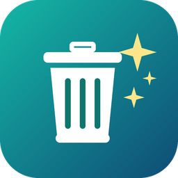
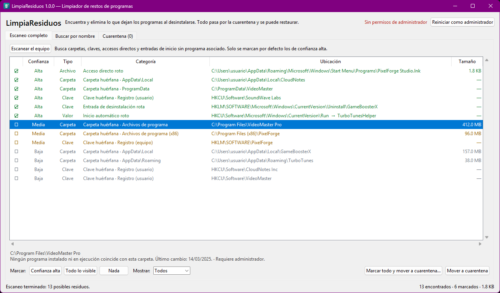
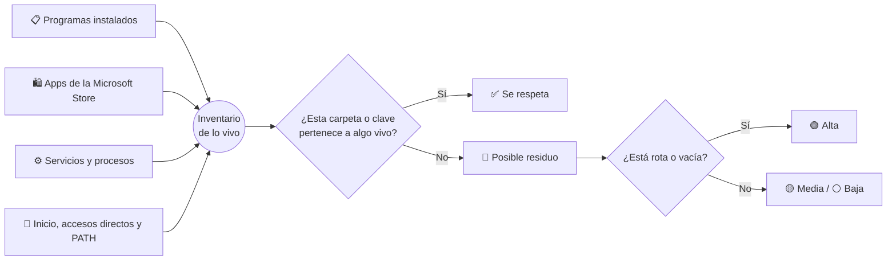

<div align="center">



# LimpiaResiduos

**Desinstalaste el programa. Pero el programa no se fue del todo.**

*Carpetas fantasma, claves de registro huérfanas, accesos directos que llevan a ninguna parte…
LimpiaResiduos las encuentra, te las enseña y las retira sin miedo, porque todo se puede deshacer.*

[](https://github.com/HiddenOnLies/LimpiaResiduos/releases/latest/download/LimpiaResiduos.exe)


</div>

---

<p align="center">
  
  <br><sub>Captura con datos de demostración.</sub>
</p>

## 👻 El problema

Cada desinstalador «oficial» deja algo atrás:

```
C:\Program Files\VideoMaster Pro\            ← 412 MB de un programa que ya no existe
%APPDATA%\TurboTunes\                       ← configuración de hace dos años
HKCU\Software\SoundWave Labs                ← clave del registro huérfana
Menú Inicio › PixelForge Studio.lnk         ← acceso directo que no abre nada
Run › TurboTunesHelper                      ← Windows intenta arrancarlo en cada inicio
```

Uno a uno no pesan nada. Juntos son gigas de basura, un registro desordenado y errores silenciosos al arrancar.

## ✨ Lo que hace

| | |
|---|---|
| 🔍 **Escaneo completo** | Revisa Archivos de programa, ProgramData, AppData, el registro, el menú Inicio, el escritorio y los programas de inicio. |
| 🎯 **Buscar por nombre** | ¿Acabas de quitar «Wondershare»? Escríbelo y verás todo lo que dejó. |
| 🚦 **Niveles de confianza** | 🟢 Alta, 🟡 Media o ⚪ Baja. Solo se marcan solos los 🟢 Alta, que están claramente rotos. |
| 🧳 **Cuarentena** | Nada se borra a lo bruto: se mueve a un lugar seguro y se restaura con un clic. |
| 💾 **Copia de seguridad en ZIP** | Con «Marcar todo y mover» te ofrece una copia con un nombre que se entiende: `Copia de seguridad LimpiaResiduos 21-10-2026 14.30 (57 elementos).zip`. |
| 🙈 **Lista de ignorados** | Clic derecho › «No es un residuo» y no vuelve a aparecer. |

## 🧠 Cómo sabe qué es basura

LimpiaResiduos no adivina: hace inventario de todo lo que **sí** está vivo en tu equipo y sospecha de lo que no aparece en él.



Algunas reglas de sentido común:

- **Nunca** propone nada de Windows, Microsoft ni de fabricantes de hardware (Intel, NVIDIA, AMD, Realtek…).
- Una carpeta modificada en los últimos 30 días baja a confianza ⚪ Baja, porque alguien la está usando.
- Una clave del registro que apunta a archivos que todavía existen se descarta.
- En `Adobe\`, `Valve\` y otras carpetas de fabricante, revisa cada producto por separado.

## 🛡️ Hecho para no romper nada

> [!IMPORTANT]
> LimpiaResiduos **nunca borra directamente**. Todo pasa primero por la cuarentena.

- 📦 **Carpetas y archivos**: se *mueven* a `%LOCALAPPDATA%\LimpiaResiduos\Cuarentena`.
- 🗝️ **Claves del registro**: se exportan a un `.reg` antes de borrarlas.
- 🔒 **Archivos en uso**: si algo está abierto, la carpeta no se mueve. Nunca quedan copias a medias.
- 🧱 **Lista negra fija**: aunque las marques, se niega a tocar Windows, Archivos de programa, AppData, tu perfil, Documentos, Escritorio y claves críticas como `Microsoft`, `Classes` o `Policies`.

Cuando compruebes que todo va bien, vacía la cuarentena desde su pestaña.

## 🚀 Empezar

### Opción A: el ejecutable (recomendada)

1. Descarga **[LimpiaResiduos.exe](https://github.com/HiddenOnLies/LimpiaResiduos/releases/latest/download/LimpiaResiduos.exe)** desde las [Releases](https://github.com/HiddenOnLies/LimpiaResiduos/releases).
2. Ábrelo. No hace falta instalarlo.
3. Pulsa **Escanear el equipo**.

> [!NOTE]
> Windows SmartScreen puede avisar de que el ejecutable «no es reconocido», porque no está firmado digitalmente. Pulsa **Más información › Ejecutar de todas formas**. Si lo prefieres, usa la opción B y ejecuta el código fuente directamente.

### Opción B: desde el código fuente

Requiere Python 3.12 o superior y nada más.

```bash
git clone https://github.com/HiddenOnLies/LimpiaResiduos.git
cd LimpiaResiduos
python LimpiaResiduos/app.py
```

O haz doble clic en `LimpiaResiduos\Iniciar.bat`.

### Compilar tu propio .exe

```bash
compilar.bat
```

Genera `dist\LimpiaResiduos.exe` con [PyInstaller](https://pyinstaller.org).

### Por consola (solo lectura)

```bash
python LimpiaResiduos/scanner.py              # escaneo completo
python LimpiaResiduos/scanner.py wondershare  # restos de un programa concreto
```

## 🔐 ¿Y los permisos de administrador?

Sin ellos, LimpiaResiduos limpia todo lo de **tu usuario**: AppData, tu registro, tu menú Inicio y tu escritorio. Para tocar Archivos de programa, ProgramData o el registro del equipo, pulsa **Reiniciar como administrador** dentro de la app.

## 🗂️ Estructura

```
LimpiaResiduos/
├── app.py        Interfaz (tkinter)
├── scanner.py    Detección de residuos (solo lectura)
├── cleaner.py    Cuarentena, copias de seguridad y restauración
├── rules.py      Qué se analiza y qué es intocable
├── winutil.py    Registro, carpetas conocidas y procesos
├── lnk.py        Lector de accesos directos .lnk
└── LEEME.md      Guía de uso detallada
```

## ❓ Preguntas frecuentes

<details>
<summary><b>¿Puedo marcar todo sin mirar?</b></summary>

Puedes, y la app te deja hacerlo, pero no es buena idea con lo de confianza ⚪ Baja. Ahí puede haber partidas guardadas, programas portátiles o configuraciones que quieras conservar. Por eso el botón «Marcar todo» ofrece primero una copia de seguridad en ZIP.
</details>

<details>
<summary><b>He movido algo a la cuarentena y ahora un programa falla</b></summary>

Pestaña **Cuarentena** › selecciónalo › **Restaurar**. Vuelve a su sitio tal cual estaba. Después, clic derecho › «No es un residuo» para que no vuelva a aparecer.
</details>

<details>
<summary><b>¿Envía datos a algún sitio?</b></summary>

No. Funciona sin conexión, no tiene telemetría y no usa librerías de terceros. Todo el código está aquí.
</details>

<details>
<summary><b>¿Por qué el .exe pesa ~12 MB?</b></summary>

Incluye un Python completo para que no tengas que instalar nada.
</details>

## 📜 Licencia

[MIT](LICENSE). Úsalo, modifícalo y compártelo.

<div align="center">
<br>
<sub>Hecho con 🧹 para que tu PC no guarde recuerdos de programas que ya olvidaste.</sub>
</div>
